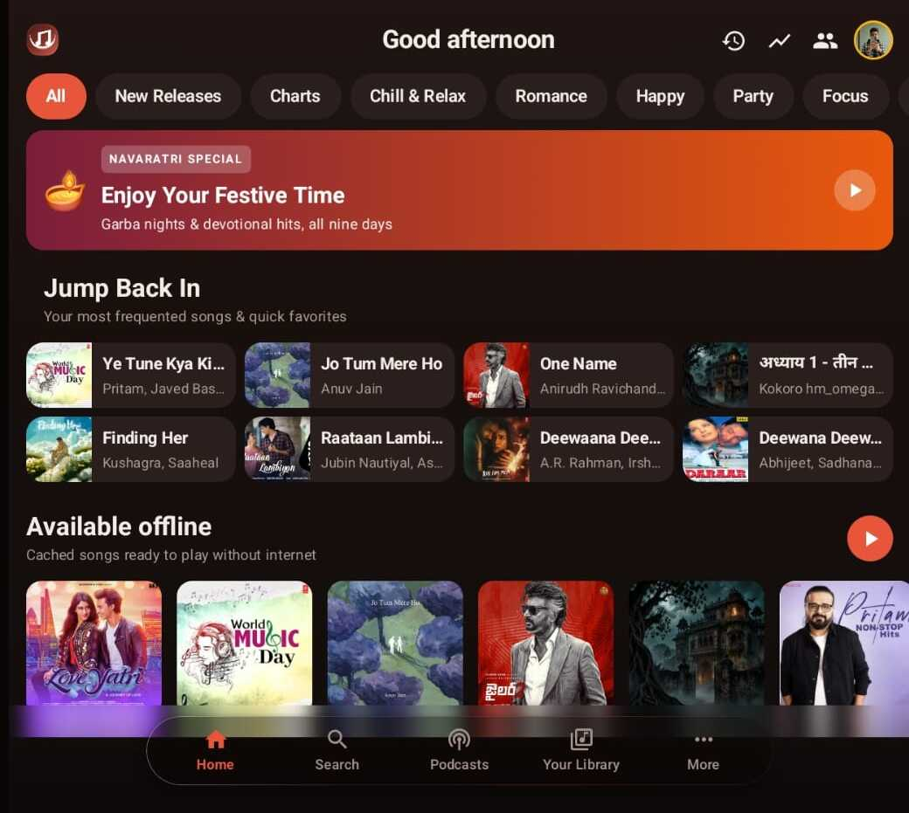
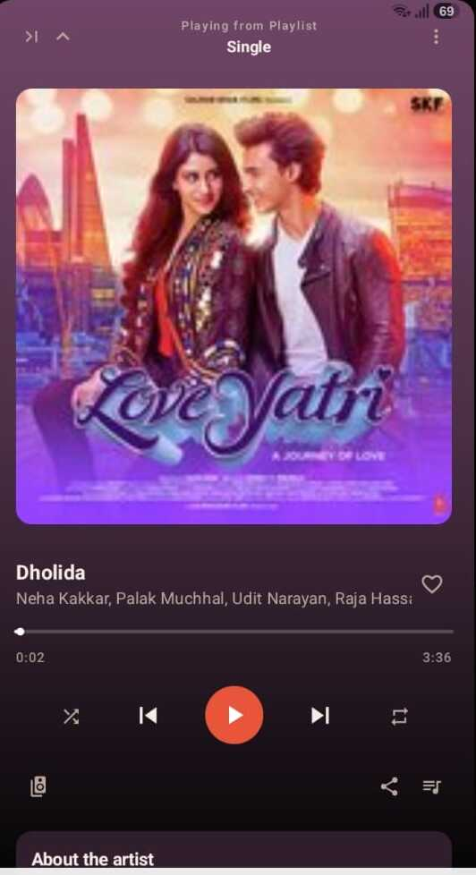
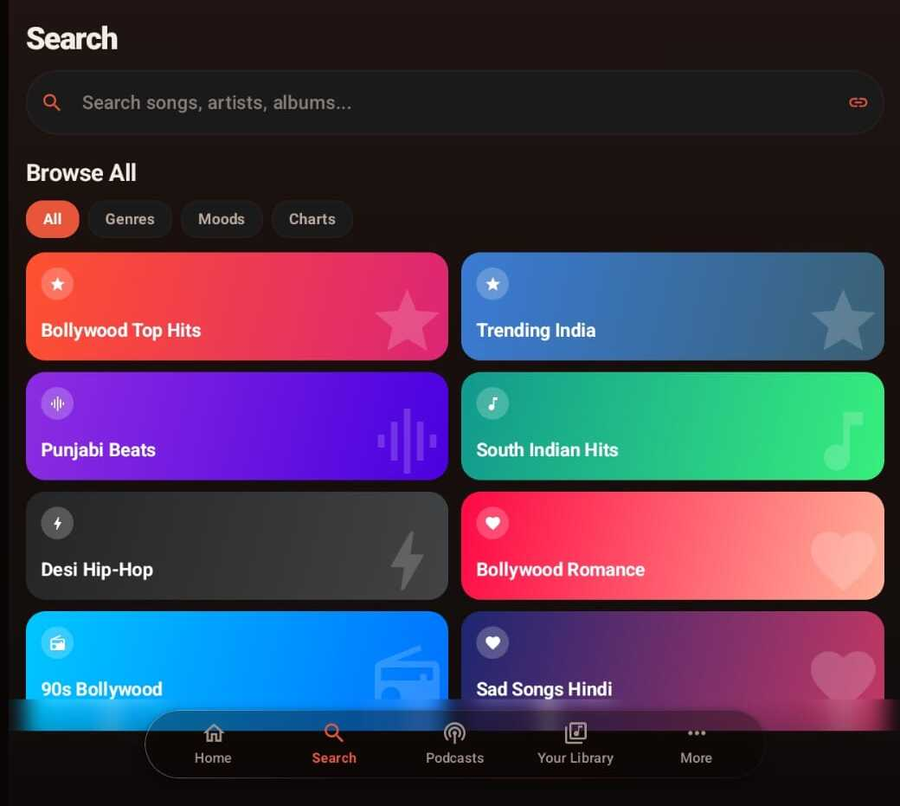
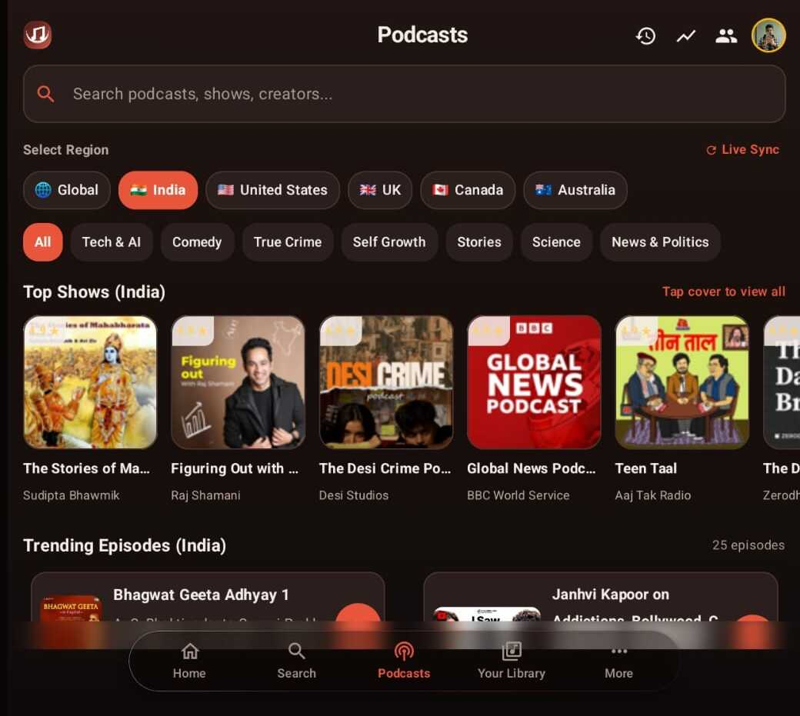
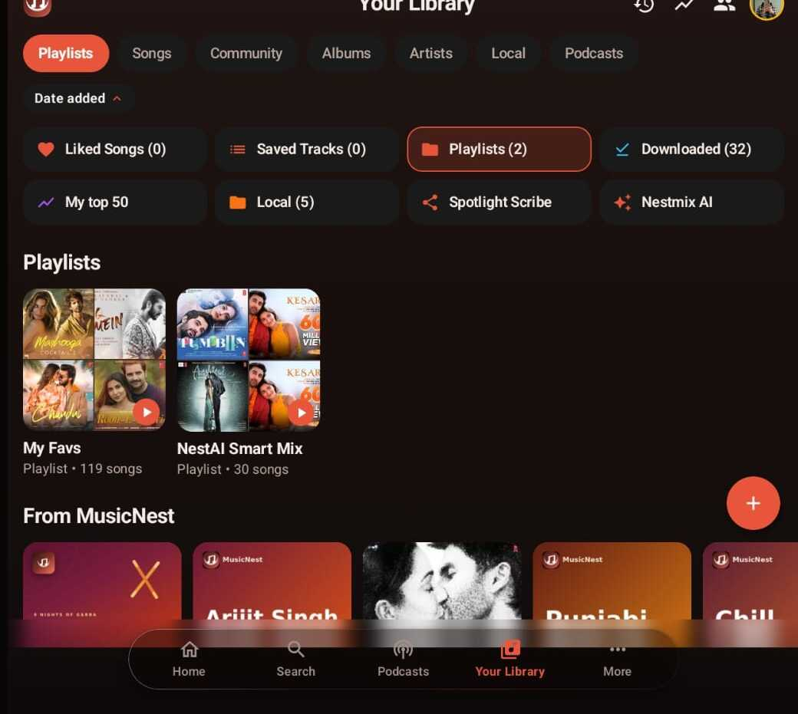
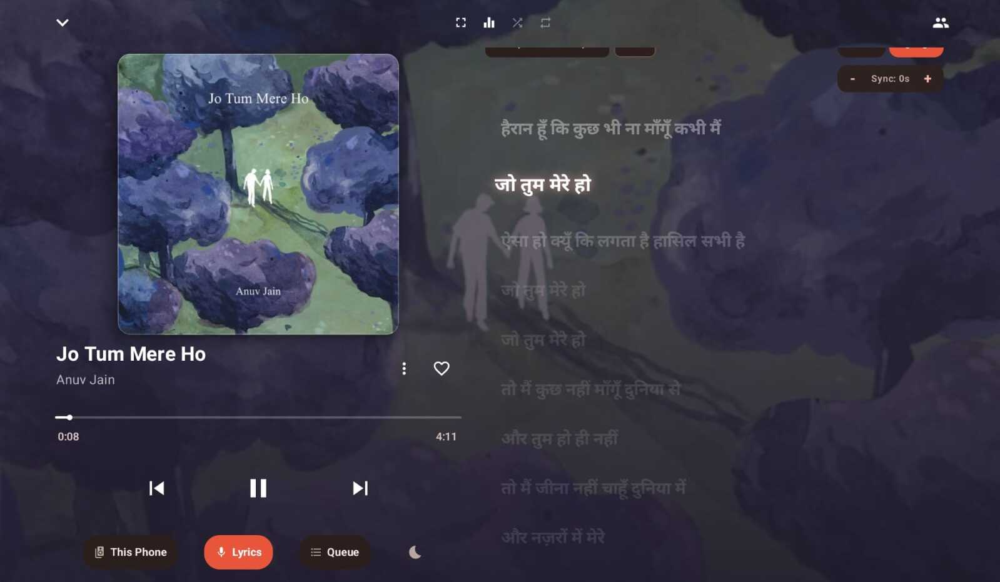

# MusicNest

**Ad-free music streaming for Android. Synced lyrics, offline cache, a clean player.**

[**Download**](https://github.com/dev-stack12692/MusicNest/releases/latest) · [**Website**](https://musicnest.me) · [**Report a bug**](https://github.com/dev-stack12692/MusicNest/issues) · [**Support**](mailto:support@musicnest.me)

---

## Overview

MusicNest is a free Android music app I built because I got tired of ads between songs. Search a song, press play, and keep listening. No audio ads, no paywall.

It is made for Indian listeners first, so the home feed leans towards Hindi and regional music.

> [!NOTE]
> MusicNest is free to use, but it is not open source. This repository only hosts the APK releases, the terms and the docs. The source code is not published and all rights are reserved.

---

## Screenshots

<table>
  <tr>
    <td align="center"><b>Home</b>  </td>
    <td align="center"><b>Now Playing</b>  </td>
    <td align="center"><b>Search</b>  </td>
  </tr>
  <tr>
    <td align="center"><b>Podcasts</b>  </td>
    <td align="center"><b>Your Library</b>  </td>
    <td align="center"><b>Synced Lyrics</b>  </td>
  </tr>
</table>

---

## Features

- **No audio ads.** Just your music.
- **Synced lyrics.** Lines highlight as the song plays, with a sync nudge if a track is slightly off.
- **Offline cache.** Songs you play are kept on your device so they play again without internet.
- **Smart home feed.** Jump Back In, mood categories and daily mixes built from what you listen to.
- **Fast search.** Songs, artists and albums in one place.
- **Podcasts.** A dedicated tab next to music.
- **Library and playlists.** Favourites, playlists and history on your device.
- **Listen Together.** Share a room code and play the same song with a friend.
- **Equalizer.** Sliders and saved profiles.
- **Data saver.** Adaptive stream quality for slow or limited connections.
- **Media controls.** Notification and lock screen controls.

---

## Download

| Platform | Requirement | Get it |
| :--- | :--- | :---: |
| **Android** | Android 8.0 or newer | [**Latest APK**](https://github.com/dev-stack12692/MusicNest/releases/latest) |

Also available at **[musicnest.me](https://musicnest.me)**.

**Installing:** download the APK, open it, and allow "Install unknown apps" for your browser or file manager when Android asks (`Settings > Apps > Special app access > Install unknown apps`).

---

## Docs

[Terms](TERMS.md) · [Privacy Policy](PRIVACY_POLICES.md) · [Disclaimer](DISCLAIMER.md) · [Security](SECURITY.md) · [Changelog](CHANGELOG.md) · [About](ABOUT.md) · [My Story](MY_STORY.md)

MusicNest does not host or store any music files. Song names, artwork and audio belong to their respective owners. The app is provided as is, with no warranty. Please use it lawfully and read the [Terms](TERMS.md) before installing.

---

## Feedback and Help

Found a bug or want a feature? [Open an issue](https://github.com/dev-stack12692/MusicNest/issues) or write to **support@musicnest.me**. Bug reports with your phone model and app version help the most.

---

## Support the Project

MusicNest stays free. If you like it and want to buy me a chai, you can pay by UPI.

On mobile, tap the badge. Otherwise pay to UPI ID `7318708749@ibl` (Swapnendu Mal).

---

## License

Free to use. Source code not published. All rights reserved. No redistribution, modification or reverse-engineering.

Built by a music lover, for music lovers.

